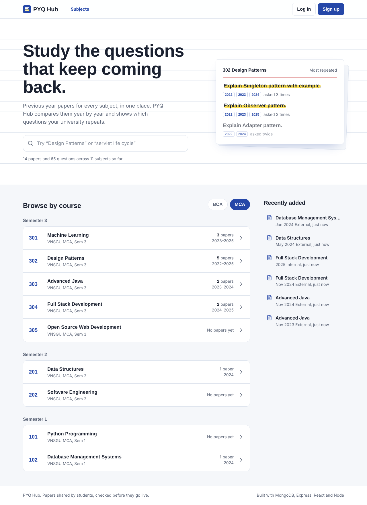
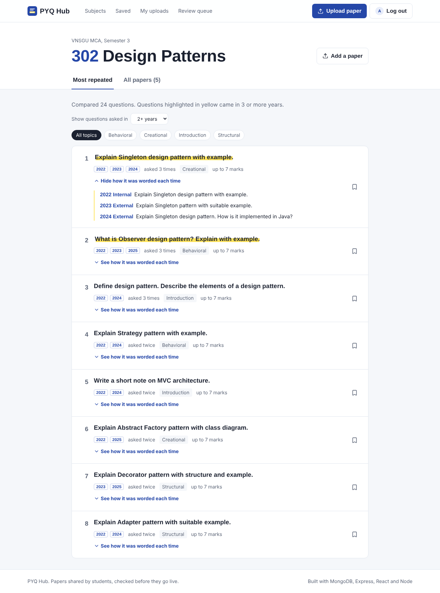
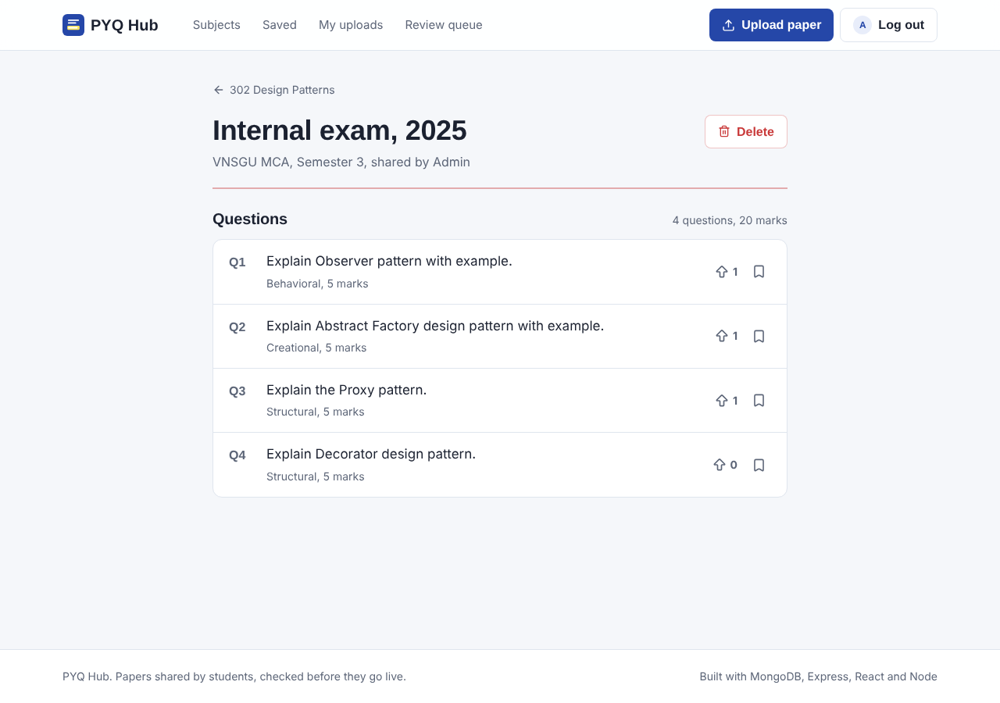
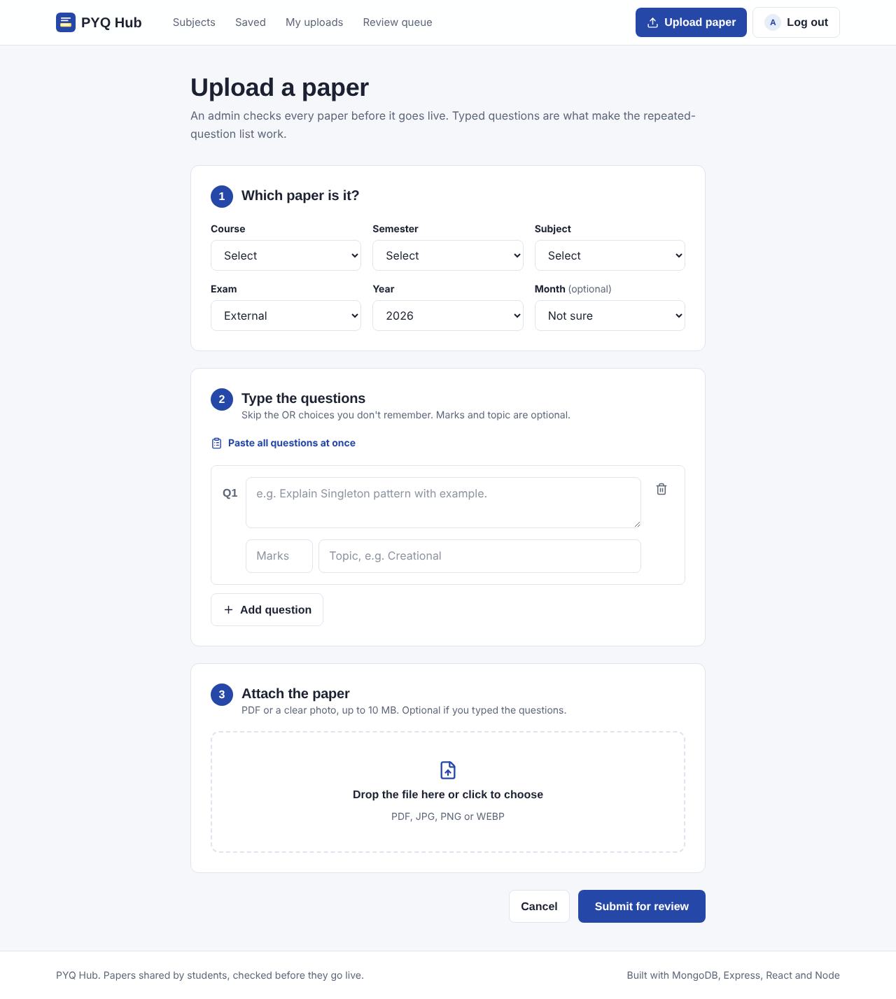
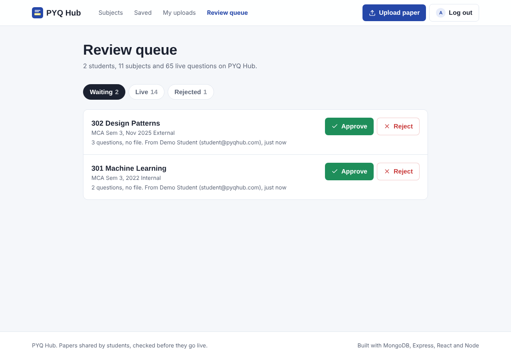

# PYQ Hub
**Live demo:** https://pyq-hub.vercel.app
Previous year question papers, organised by subject, with a list of the questions that keep repeating across years.

Before exams, students hunt for old papers in WhatsApp groups and blurry photos, and nobody really knows which questions come every year. PYQ Hub keeps all papers of a subject in one place, compares their questions year by year, and shows the repeated ones first.



## Features

- **Most repeated questions** for every subject. Questions from different years are matched even when the wording changes ("Explain Singleton pattern with example" and "Explain Singleton design pattern. How is it implemented in Java?" count as the same question).
- Browse by course and semester, or search subjects and questions.
- Students upload papers (PDF or photo) and type the questions, or paste all of them at once.
- Admin review queue: every upload stays private until an admin approves it. Rejected uploads show the reason to the student.
- Upvote important questions, and save questions to a personal revision list.
- Login with JWT stored in an httpOnly cookie, passwords hashed with bcrypt.
- Responsive UI, works on phone.

| Subject page | Paper page |
| --- | --- |
|  |  |
| **Upload** | **Admin review queue** |
|  |  |

## Tech stack

| Part | Used |
| --- | --- |
| Frontend | React 19, React Router, Tailwind CSS 4, Axios, Vite |
| Backend | Node.js, Express 5 |
| Database | MongoDB with Mongoose |
| Auth | JWT (httpOnly cookie), bcrypt |
| File upload | Multer, Cloudinary (falls back to local `uploads/` folder) |
| Security | Helmet, CORS with credentials, rate limiting on login/register |

## How repeated questions are found

Code: [`server/src/utils/similarity.js`](server/src/utils/similarity.js)

1. When a question is saved, its text is cleaned into **keywords**: lowercase, punctuation removed, common exam words removed (*explain, what, write, example, short note...*), plurals reduced (*patterns → pattern*).
   `"Explain Singleton design pattern with example."` → `["singleton", "design", "pattern"]`
2. Two questions are compared using **Jaccard similarity** = common keywords ÷ total unique keywords.
   `["singleton","pattern"]` vs `["singleton","design","pattern"]` → 2 / 3 = 0.67
3. If similarity is **0.6 or more**, they are treated as the same question. Questions are grouped one by one: each question joins the first group that already has a similar question, otherwise it starts a new group.
4. Groups that appear in 2 or more different years are shown, sorted by number of years, then times asked, then upvotes.

Keywords are stored with the question (pre-save hook), so they are not recalculated on every request.

**Known limits:** abbreviations are not matched with full forms ("KNN" vs "K-Nearest Neighbour"), and it is word matching, not meaning. A future version could use text embeddings.

## Project structure

```
pyq-hub/
├── server/
│   └── src/
│       ├── config/        db connection, file storage (Cloudinary / local)
│       ├── models/        User, Subject, Paper, Question
│       ├── controllers/   logic for each route
│       ├── routes/        Express routers
│       ├── middleware/    auth (protect, adminOnly), upload, error handler
│       ├── utils/         similarity logic, AppError
│       └── seed/          demo data
└── client/
    └── src/
        ├── api/           axios instance
        ├── context/       AuthContext (logged-in user)
        ├── components/    Navbar, QuestionActions, common UI
        └── pages/         Home, Auth, Subject, Paper, Upload, Bookmarks, MyUploads, Admin
```

## Database design

- **User**: name, email, password (hashed, `select: false`), role (`student` / `admin`), bookmarks (Question ids)
- **Subject**: university, course, semester, name, code. Unique on university + course + semester + name.
- **Paper**: subject, year, month, examType (`internal` / `external` / `retest`), file URL, uploadedBy, status (`pending` / `approved` / `rejected`), rejectReason, views
- **Question**: paper, subject, year, text, marks, topic, keywords, upvotes (User ids), upvoteCount, isApproved

`subject` and `year` are copied into Question so subject-wise queries don't need to join through Paper. `isApproved` follows the paper's status, so unapproved questions never show up in search or the repeated list.

## API

| Method | Route | Access | Purpose |
| --- | --- | --- | --- |
| POST | `/api/auth/register` | Public | Create account (always as student) |
| POST | `/api/auth/login` | Public | Login, sets cookie |
| POST | `/api/auth/logout` | Public | Clears cookie |
| GET | `/api/auth/me` | User | Current user |
| GET | `/api/stats` | Public | Counts for home page |
| GET | `/api/subjects` | Public | List, filter by `course`, `semester`, `q` |
| GET | `/api/subjects/filters` | Public | Dropdown values |
| GET | `/api/subjects/:id` | Public | Subject + approved papers |
| GET | `/api/subjects/:id/important` | Public | Repeated questions (`minYears`) |
| POST / DELETE | `/api/subjects(/:id)` | Admin | Add / remove subject |
| GET | `/api/papers/recent` | Public | Latest approved papers |
| GET | `/api/papers/mine` | User | My uploads with status |
| GET | `/api/papers/:id` | Public* | Paper + questions (*pending only for owner/admin) |
| POST | `/api/papers` | User | Upload (multipart: file + questions JSON) |
| DELETE | `/api/papers/:id` | Owner (pending) / Admin | Delete paper, questions and file |
| GET | `/api/questions/search?q=` | Public | Search question text |
| POST | `/api/questions/:id/upvote` | User | Toggle upvote |
| POST | `/api/questions/:id/bookmark` | User | Toggle save |
| GET | `/api/questions/bookmarks` | User | Saved questions |
| GET | `/api/admin/stats` | Admin | Counts |
| GET | `/api/admin/papers?status=` | Admin | Papers by status |
| PATCH | `/api/admin/papers/:id/status` | Admin | Approve / reject (reason required) |

## Run it locally

You need **Node.js 20+** and **MongoDB** (local MongoDB Community Server, or a free MongoDB Atlas cluster).

**1. Backend**

```bash
cd server
npm install
cp .env.example .env      # on Windows: copy .env.example .env
```

Open `server/.env`, set `MONGO_URI` and a long random `JWT_SECRET`. Then:

```bash
npm run seed    # adds demo subjects, papers and two users (deletes existing data)
npm run dev     # starts API on http://localhost:5000
```

**2. Frontend** (in a second terminal)

```bash
cd client
npm install
npm run dev     # opens on http://localhost:5173
```

Vite forwards `/api` calls to the backend, so no extra config is needed locally.

**Demo logins** (created by the seed script)

| Role | Email | Password |
| --- | --- | --- |
| Student | student@pyqhub.com | Student@123 |

## Deploy

1. **Database**: create a free cluster on MongoDB Atlas, copy the connection string.
2. **Files**: create a free Cloudinary account, copy cloud name, API key and secret. (Render's disk is wiped on restart, so local uploads won't survive.)
3. **Backend on Render**: new Web Service, root directory `server`, build `npm install`, start `npm start`. Add env vars from `.env.example`, with `NODE_ENV=production`, `CLIENT_URL=<your Vercel URL>` and `SERVER_URL=<your Render URL>`.
4. **Frontend on Vercel**: import the repo, root directory `client`, add `VITE_API_URL=<your Render URL>`. `client/vercel.json` already sends every route to `index.html`, so refreshing a page works with React Router.

In production the cookie uses `sameSite: "none"` and `secure: true`, because the frontend and backend are on different domains.

## Ideas for later

- Read questions from the uploaded PDF automatically (OCR)
- Email when an upload is approved
- Topic-wise weightage chart for each subject
- Report a wrong question
